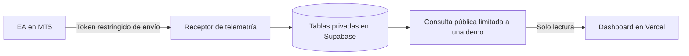

# Dashboard público de telemetría MT5

Autoría: QRT Solutions.

Los diez KPI aprobados están integrados mediante `src/kpis.mjs` y la RPC
`mt5_public_dashboard_kpis`. La [muestra local](../kpi-laboratorio/README.md)
mantiene su conjunto de indicadores educativos y datos simulados por separado;
no se importan sus fixtures al dashboard.

La interfaz vive en **Vercel** y lee la telemetría desde **Supabase**. MT5 debe
seguir abierto y conectado para enviar nuevos estados. Si se apaga, la web sigue
accesible y muestra la antigüedad del último dato recibido.

La interfaz toma como referencia visual `dashboard_traders_dual.html` del docente:
logo Pepperstone, cabecera compacta, seis tarjetas de cuenta, cuatro resúmenes con etiquetas
de color, gráficos antes de las bitácoras y tablas con distintivos BUY/SELL.
Los enlaces superiores llevan a resumen, resultados, posiciones, comentarios y
ejecuciones. El original se conserva sin cambios. El recurso de marca está en
`src/pepperstone.png`, incluido por el build y el servidor de vista previa. Las operaciones provienen del
EA; los motivos de muestra conservan la procedencia documentada en
[ESTADO](../../ESTADO.md).

La adaptación es visual: no importa los datos de prueba, estrategias, métricas
porcentuales ni la afirmación «auditado» de la referencia. El margen utilizado
procede directamente del snapshot. Los totales del historial abarcan todo el
filtro; gráficos y exportación corresponden a la página actual. La bitácora de
comentarios conserva su paginación independiente y la edición con Telegram.
En celular las tablas se convierten en tarjetas; los campos y botones mantienen
un tamaño táctil. Las métricas aún no disponibles se consultan en el desplegable
**Métricas avanzadas · Disponibilidad de datos**.

## Qué muestra

### Curvas y distribución de resultados

Aplicar [dashboard_distribuciones.sql](../../supabase/sql/dashboard_distribuciones.sql)
después del SQL de KPI. `performance-charts.mjs` añade cuatro gráficos con Chart.js
local: histogramas de retorno del precio y neto monetario, curva de retorno puro
acumulado (total y contribución de compras/ventas) y curva de neto acumulado.
Usan la misma respuesta RPC, filtros y operaciones completas que los diez KPI.
Cambiar páginas o el filtro de ejecución no cambia su población.

Un histograma divide los resultados en intervalos: altura = número de operaciones
en el intervalo. Se utilizan doce intervalos iguales entre mínimo y máximo, o uno
si todos los resultados coinciden. Se incluye el límite inferior y se excluye el
superior, excepto el último, que incluye el máximo. Los intervalos vacíos se
conservan con frecuencia cero. Al cambiar filtros se recalculan los límites.

Una curva acumula resultados como un contador: punto nuevo = acumulado anterior
+ resultado de la operación completa que acaba de cerrar. La base es cero y el
eje horizontal es el número de cierres ordenados por hora broker e ID interno;
el ID no se publica. Los tooltips conservan la hora broker. El retorno es suma
aritmética antes de costes, no capitalización ni rentabilidad de la cuenta. El
neto utiliza costes recibidos de posiciones completas, no equity histórica.

La respuesta incluye hasta 400 puntos. Si hay más operaciones, se agrupan cierres
consecutivos manteniendo el último acumulado y los extremos del rango de fechas
de cada grupo. La interfaz indica la agrupación; no muestra oscilaciones dentro
del grupo ni permite deducir drawdown intragrupo. Los histogramas siempre cuentan
toda la muestra. Cada gráfico incorpora **Ver datos y valores exactos**, una tabla
accesible por teclado. Muestras vacías o consulta fallida ocultan los gráficos.

Pruebas: fixtures SQL con extremos, neutros, un resultado, filtro vacío, compras,
ventas, parciales y más de 400 cierres; modelos de gráficos en `npm test`;
verificación del navegador en escritorio y móvil, filtros, páginas, recuperación
tras error HTTP y conciliación del final de las curvas con los KPI.

### Definiciones y cobertura de los diez KPI

Instalar [dashboard_kpis.sql](../../supabase/sql/dashboard_kpis.sql) después de la
consulta paginada. Presenta patrimonio, drawdown actual/máximo, riesgo hasta SL,
neto del período, retorno puro acumulado, nivel de margen, Profit Factor,
tasa de acierto, ganancia/pérdida media y esperanza por operación.
Cada tarjeta incluye **Cómo se calcula** accesible con teclado y en móvil.

La nueva RPC agrega sobre todo el filtro, independientemente de las páginas de
deals o motivos. Símbolo y fechas afectan a ambas consultas; los KPI usan fecha
de cierre y conservan aperturas previas para reconstruir costes y precios.
**Dirección KPI** filtra compras/ventas de la posición original; **Ejecución** solo
filtra deals. No hay filtro de estrategia porque esa etiqueta no se recibe.
Los indicadores de cuenta conservan el snapshot completo sin filtros.

Se admiten entradas múltiples seguidas de salidas parciales con precios ponderados
por volumen. Se exige igualdad de volumen abierto/cerrado y una secuencia válida;
se excluyen INOUT, entradas posteriores a una reducción, reaperturas y cierres sin
apertura. La cobertura muestra operaciones completas y excluidas: valida los datos
observados, no demuestra que nunca faltaran ejecuciones. No se descargan todos los
trades al navegador. Las fechas siguen siendo hora del broker, no UTC normalizado.

Acierto, retorno, PF porcentual, payoff y esperanza usan retornos del precio antes
de costes; incluyen neutros en el denominador de acierto y esperanza. Neto y PF
monetario usan beneficio + comisión + swap de la operación completa, incluidas
entradas anteriores al período; no incluyen cargos separados ausentes del contrato.
Por eso el neto de estas tarjetas puede diferir del neto de deals filtrados por
fecha de ejecución. El retorno puro acumulado **no es rentabilidad de la cuenta**.

Sin muestra o denominador válido se muestra «Sin datos». Drawdown requiere una
serie de equity ajustada por flujos que aún no existe. Riesgo es cero solo con
snapshot completo, patrimonio positivo y cero posiciones; con SL ausente avisa
riesgo no acotado, y con SL presente necesita valoración monetaria adicional.
No se usa distancia de precios ni lotes como sustituto del riesgo en dinero.
Con margen cero se informa «Sin margen utilizado».

Verificación: `npm test`, `npm run build`, pruebas SQL locales con
[fixtures y ROLLBACK](../../supabase/sql/verificar_dashboard_kpis.sql), comparación
de la respuesta RPC con las tarjetas, filtros BUY/SELL, período vacío y cambio
de página sin alteración de los KPI. Probar 320, 390, 768 y 1440 px.

| Vista | Fuente y significado |
|---|---|
| Balance, equity, flotante, margen libre y utilizado | Último snapshot completo de MT5 |
| Posiciones abiertas | Estado actual; no son órdenes para ejecutar |
| Historial y neto por símbolo | Ejecuciones BUY/SELL recibidas; beneficio + comisión + swap |
| Neto acumulado | Suma secuencial de los registros seleccionados; **no** es equity histórica |
| Tasas de swap | Valores nativos del broker; la unidad depende del modo MT5 |
| Retorno puro, PF porcentual y monetario, acierto, payoff, esperanza y neto cerrado | RPC adicional; operaciones completas de todo el período por fecha de cierre, símbolo y dirección original |
| Drawdown, Sharpe, MAE/MFE y estrategia | Sin datos con la cobertura actual; no se inventan |
| Riesgo hasta SL y nivel de margen | Riesgo cero solo sin posiciones; SL sin valoración monetaria deja riesgo sin datos; nivel = equity / margen × 100 |

La unidad del historial es el **deal**, no una posición completa. Un deal SELL
puede cerrar una compra. El histórico recibido de v3.20 contiene principalmente cierres y
puede omitir comisiones de entradas previas; v3.40 prepara entradas y salidas,
pero hay que verificar su recepción antes de asumir cobertura completa. Su neto no reconcilia necesariamente
con la variación del balance. Las fechas de deals se muestran como hora del broker,
sin tratarlas como UTC; la hora de recepción sí proviene del servidor y es UTC.

El servidor entrega páginas de **25 ejecuciones** y **10 operaciones**. Los
filtros se aplican en Supabase; las tarjetas monetarias suman todo el filtro.
Los gráficos y la exportación contienen únicamente la página descargada, como
indica la interfaz. El estado se consulta cada 30 segundos y el historial cada
2 minutos con la pestaña visible; filtros, páginas, guardado y Actualizar fuerzan
una consulta completa. Tras 120 segundos sin recepción se señala atraso.

En celular, posiciones, ejecuciones y bitácora aparecen como tarjetas. En
computador se conservan tablas. La columna **Cambios de SL / TP** muestra los
últimos diez grupos por operación, con anterior/nuevo, hora UTC de observación,
número de cambios y motivo editable mediante la sesión existente. El total de
grupos permite reconocer cobertura limitada; todos los eventos se conservan en
la base. Los detalles de cada ejecución se despliegan por separado.

## Separación de permisos



La publicación pública es **optativa**. Ser una demo no autoriza al agente a
publicarla: debe existir autorización del propietario. En la instalación docente
el usuario pidió expresamente acceso público sin inicio de sesión.

La función `mt5_public_dashboard_page()` no recibe identificadores de cuenta. Lee una
sola publicación habilitada y comprueba `account_type = 'DEMO'` en cada consulta.
Devuelve una lista explícita de campos y excluye login, servidor, account_id,
tickets y credenciales. Las tablas originales mantienen RLS y ningún permiso
SELECT/INSERT/UPDATE/DELETE para `anon` o `authenticated`.

Se utiliza `SECURITY DEFINER` deliberadamente para esta proyección limitada, con
`search_path` vacío, nombres de tablas completos, sin SQL dinámico ni escrituras.
Los asesores de Supabase advierten que la función es ejecutable públicamente:
ese es su propósito autorizado; **no** significa que el asesor esté sin avisos.
Los avisos RLS sin políticas corresponden a tablas cerradas al cliente.
Consultar los controles de [funciones públicas](https://supabase.com/docs/guides/database/database-linter?lint=0028_anon_security_definer_function_executable)
y [RLS sin políticas](https://supabase.com/docs/guides/database/database-linter?lint=0008_rls_enabled_no_policy).

La clave `sb_publishable_…` es pública por diseño. No concede escritura ni acceso
a las tablas privadas. No usar `service_role`, `sb_secret_…`, contraseña de base
de datos o token del EA en esta aplicación. El cierre remoto sigue desactivado;
no hay controles ni API de trading en el dashboard.

## Reproducir con tu agente

Primero completa el [receptor y EA](../../supabase/RECEPTOR.md) en **tu propio**
proyecto. Después entrega este mensaje a Codex, Claude Code o Antigravity:

```text
Lee AGENTS.md y seminario_3/aplicaciones/web/README.md. Quiero desplegar este
 dashboard con los datos de mi cuenta demo. Comprueba primero receptor, tablas,
 cuenta y conectores disponibles; no reutilices el proyecto ni credenciales
 del docente. Antes de publicar datos, confirma si quiero acceso público.
 Si autorizo publicación pública, aplica solo el SQL que falte, habilita mi
 cuenta demo y usa exclusivamente la clave publishable en la web. Mantén tablas
 y credenciales privadas. Compila la aplicación, verifica permisos, filtros,
 gráficos y datos reales. Despliega en mi proyecto Vercel y comprueba la URL
 de producción sin sesión. Documenta resultados y pendientes; no operes en MT5.
```

### 1. Habilitar la lectura pública de una demo

Revisa primero tablas y migraciones existentes. Aplica una sola vez
[`dashboard_publico.sql`](../../supabase/sql/dashboard_publico.sql) después de las
migraciones del receptor, mediante el conector `apply_migration` o el SQL Editor
con una sesión administrativa. Es SQL de referencia, no una migración CLI con
nombre inventado; si usas Supabase CLI, genera el archivo con `supabase migration new`.

Para mostrar comentarios y motivos, instala también `bitacora_trades.sql` antes
de usar la aplicación actual; sigue el [orden SQL completo](../../supabase/sql/README.md).
No basta con la versión inicial de la consulta pública.

Esta migración crea una tabla de publicación vacía y la función de lectura;
no habilita automáticamente ninguna cuenta. Inspecciona el snapshot de tu cuenta
y sustituye el marcador siguiente usando el editor administrativo:

```sql
-- Author: QRT Solutions. Solo con autorización de publicación de esta demo.
insert into public.mt5_dashboard_publication
  (singleton, account_id, enabled, display_name)
select true, account_id, true, 'Mi cuenta demo'
from public.mt5_accounts_snapshot
where account_id = 'ID_DE_TU_CUENTA_DEMO' and account_type = 'DEMO'
on conflict (singleton) do update
set account_id = excluded.account_id, enabled = excluded.enabled,
    display_name = excluded.display_name;

select public.mt5_public_dashboard_page();
```

Verifica que el `account_id` elegido corresponde a tu demo. Si no existe o es
real, el INSERT no debe publicar nada nuevo; revisa cualquier publicación anterior.
Nunca habilites todas las cuentas. Para **retirar** la publicación:

```sql
-- Author: QRT Solutions. Revoca futuras lecturas; no retira copias ya descargadas.
update public.mt5_dashboard_publication set enabled = false where singleton;
```

La siguiente consulta del navegador devolverá `account: null` y ocultará los datos.
No modifica ni detiene el envío del EA.

### 2. Configurar y ejecutar localmente

Requisitos: Node.js 22.19 o posterior compatible y npm. Chart.js 4.4.1 está fijado
en `package.json` y `package-lock.json`, se instala desde npm y se incluye en el
build; no se descarga desde un CDN al abrir la página. No se requiere un framework.

Desde esta carpeta:

```bash
npm ci
cp .env.example .env.local
# Edita .env.local con los dos valores públicos de tu proyecto.
npm test
npm run dev
```

| Variable | Valor que debes usar |
|---|---|
| `PUBLIC_SUPABASE_URL` | Project URL de tu proyecto: `https://TU_REFERENCIA.supabase.co` |
| `PUBLIC_SUPABASE_PUBLISHABLE_KEY` | Clave moderna `sb_publishable_…` de Settings → API Keys |

La vista previa abre en `http://127.0.0.1:4173`. `npm run build` genera `dist/`.
El proceso rechaza claves que no sean publishable. `.env.local`, `dist/`,
`node_modules/` y `.vercel/` quedan fuera de Git. Solo hay ejemplos en el clon.

### 3. Desplegar en Vercel

Crea o selecciona un proyecto propio. Para importar el repositorio configura:

| Ajuste | Valor |
|---|---|
| Root Directory | `seminario_3/aplicaciones/web` |
| Framework | Other |
| Node.js | 22.x o una versión compatible posterior |
| Install Command | `npm ci` |
| Build Command | `npm run build` |
| Output Directory | `dist` |
| Variables de producción | Las dos variables públicas anteriores |

Con MCP también se puede desplegar una lista explícita de estos archivos relativos
a la raíz de la aplicación: `package.json`, `package-lock.json`, `vercel.json`,
`scripts/build.mjs`, `src/index.html`, `src/style.css`, `src/app.mjs`,
`src/metrics.mjs`, `src/kpis.mjs`, `src/performance-charts.mjs`, `src/editor.mjs` y `src/pepperstone.png`. No enviar el repositorio
completo, `.local/`, `.env.local` ni configuraciones MCP.

En la instalación docente se utilizó inicialmente el despliegue por archivos
mediante MCP; la actualización posterior se publicó con CLI autenticada del mismo
equipo y proyecto, tras un rechazo de alcance del conector. No se conectó Git ni se
hizo commit o push. Por tanto, editar el clon no actualiza automáticamente el sitio:
hay que repetir el despliegue o configurar posteriormente la integración Git.

Verifica la **URL de producción** que devuelve Vercel. La URL generada para un
deployment puede pedir sesión aunque el dominio de producción sea público.
No desactives protecciones de previews para probar la URL equivocada.

### 4. Verificar la historia completa

1. `node --check src/app.mjs`, `npm test` y `npm run build` deben terminar bien.
2. Con **solo la clave publishable**, llama a `POST /rest/v1/rpc/mt5_public_dashboard_page`
   con cuerpo `{}` y cabecera `apikey`. Debe devolver solo la demo habilitada.
3. Con esa misma clave, intentar leer directamente snapshots, deals, credenciales
   o la tabla de publicación debe fallar. Revisa además que el rol `anon` no tenga
   permisos de escritura; no pruebes borrados contra datos reales.
4. Contrasta cifras del navegador con la consulta. Aplica filtros combinados,
   restablécelos, prueba una selección vacía y exporta JSON. La suma de la tabla,
   los gráficos y el archivo debe coincidir.
5. Abre la URL de producción sin una sesión Vercel y verifica datos, tablas y
   gráficos en escritorio y móvil. Comprueba nueva recepción del EA y la fecha
   visible; una compilación exitosa no basta.

Pruebas incluidas: coste de entrada, totales, acumulados, filtros intersectados,
valores nulos frente a cero y detección de datos atrasados. Los fixtures de pruebas
son sintéticos y nunca se incluyen en el sitio.

## Evidencia y límites

Validado en el entorno docente el 8 de octubre de 2026: consulta pública HTTP 200,
acceso directo a tablas denegado, cinco tablas con RLS y sin permisos de cliente,
cuatro pruebas unitarias aprobadas y lectura real en navegador. Los resultados de
publicación y revisión final se registran en la [bitácora](../../supabase/BITACORA.md).

La aplicación no completa el historial ausente, no reconstruye posiciones parciales,
no infiere estrategias, no registra equity histórica y no implementa autenticación
privada. Para una cuenta privada hace falta diseñar autorización por usuario antes
de habilitarla; la ruta pública actual excluye cuentas reales. Un enlace público
permite a cualquier visitante leer y descargar los campos publicados.

[Volver al seminario 3](../../README.md).
# Comentarios de apertura y cierre

Autoría: QRT Solutions. Actualización del 8 de octubre de 2026.

La sección **Comentarios de las operaciones** muestra una fila por identificador
de posición y columnas separadas de apertura y cierre. Lee `journals` de la RPC
`mt5_public_dashboard_page()`; requiere la extensión
[bitacora_trades.sql](../../supabase/sql/bitacora_trades.sql).

- **Motivo · Telegram** muestra la explicación humana guardada desde el bot.
- **MT5 · Ejecución / Orden** conserva los comentarios originales cuando el EA
  los envía. No se interpreta el Magic Number como una razón de entrada o salida.
- **Motivo pendiente** indica fase recibida sin comentario o explicación.
- **Sin apertura/cierre recibido** indica ausencia de esa fase en los datos
  cargados, no una afirmación del estado de la posición.
- Los detalles despliegan fecha del broker, dirección del deal, volumen y precio.
  Entradas parciales, salidas parciales y reversiones conservan sus ejecuciones.

Se consultan 10 posiciones por página en el servidor, con hasta 200 ejecuciones por
posición. La cobertura aparece junto al título; si se
recortaron ejecuciones, se señala en la fila. Esta tabla tiene paginación propia
y no está afectada por los filtros ni por la exportación del historial de deals.
En pantallas estrechas cada operación se presenta como una tarjeta.
El estado se actualiza cada 30 segundos; el historial cada 2 minutos o mediante **Actualizar**.

El texto se inserta con `textContent`: los comentarios no se ejecutan como HTML.
Si la exportación original no incluye comentarios, se informa de esa ausencia.
La versión del bot y del dashboard se despliegan por separado; guardar un motivo
en Supabase no actualiza por sí solo el código de Vercel.

## Edición de motivos desde la web

Disponible mediante **Entrar con Telegram** para el chat privado ya autorizado.
La lectura sigue siendo pública; únicamente se editan los motivos humanos de
apertura, cierre y grupos de cambios SL/TP, con historial y control de cambios simultáneos. Consulta el
[paso a paso de edición e instalación](EDICION.md). La clave de servicio y el token
del bot permanecen en Supabase; no se añaden secretos a Vercel.
